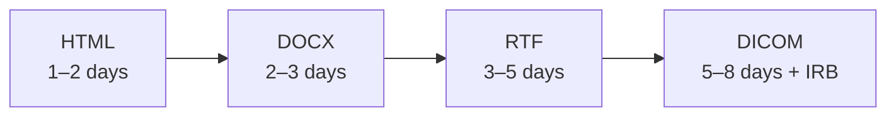

# Unsupported Format Parsers — Effort Estimates

> [!IMPORTANT]
> All parsers must be implemented under the **no-PHI-in-test-fixtures** rule.
> Use synthetic or de-identified documents in all automated tests.

| Format | Parser / Library | Effort | Notes |
|--------|-----------------|--------|-------|
| DOCX | python-docx | 2–3 days | Extract paragraphs, tables, headers. Preserve reading order. Handle embedded images (need OCR sub-path). |
| RTF | striprtf or unrtf CLI | 3–5 days | striprtf for simple files; unrtf subprocess for complex. Test against healthcare RTF (physician notes, referrals). |
| HTML | BeautifulSoup4 + html2text | 1–2 days | Strip navigation/boilerplate, extract body text, handle tables. Watch for embedded data-URIs. |
| DICOM | pydicom | 5–8 days | Extract pixel arrays (may need OCR), demographics from DICOM tags, link Patient ID to existing record. Needs IRB-cleared test corpus. Highest clinical risk. |

> [!NOTE]
> All estimates assume: one engineer, existing tests as pattern, no PHI in synthetic test fixtures.

> [!CAUTION]
> DICOM requires additional security review (sensitive radiology data containing PHI in DICOM tags).
> Do **not** commit real DICOM files to source control.

## Integration Checklist (per format)

- [ ] Add extension to the allow-list in `documents.py` (line 77)
- [ ] Add magic-byte signature check in `documents.py` `signatures` dict
- [ ] Add mime-type mapping in `documents.py` `mime_types` dict
- [ ] Implement extraction in `LocalOCRProvider.extract_text` or a dedicated parser class
- [ ] Write unit tests with synthetic fixtures (no PHI)
- [ ] Update `MAX_DOCUMENT_PAGES` logic if applicable

## Priority Order

